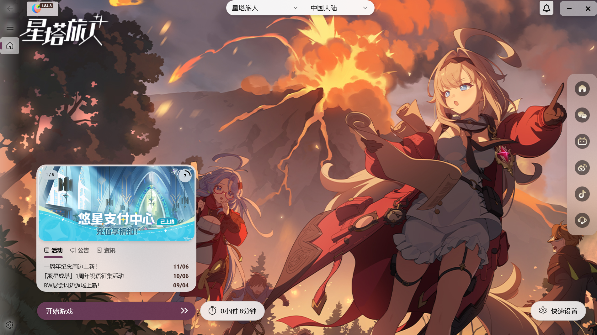

<div align="center">

# Hi3Helper.Plugin.StellaSora

[Collapse Launcher](https://collapselauncher.com/) 的《星塔旅人》第三方插件，支持游戏下载、更新和启动。

[反馈问题](../../issues)



</div>

> [!IMPORTANT]
> 使用 Windows x64 和支持插件接口 0.1.6 的 Collapse Launcher。插件问题请在本仓库反馈。

## 功能

- 识别已有的官方客户端和基础包版本。
- 从官方 CDN 下载和更新游戏，支持断点续传及文件校验。
- 显示官方背景、轮播、新闻、公告和社交入口。
- 从 Collapse 启动游戏，账号登录在游戏内完成。

## 支持区服

| 区服 | 游戏界面语言 | 官网 |
| --- | --- | --- |
| 中国大陆 | 简体中文 | [悠星国服](https://stellasora.yostar.cn/) |
| 国际服 | 英语 | [国际服官网](https://stellasora.global/) |
| 日服 | 日语 | [日服官网](https://stellasora.jp/) |
| 韩服 | 韩语 | [韩服官网](https://stellasora.kr/) |
| 台港澳繁中服 | 繁体中文 | [繁中服官网](https://stellasora.stargazer-games.com/) |

每个区服使用独立安装目录。本插件管理各服官网下载的 Windows 客户端。Steam 版连接国际服，安装与更新由 Steam 管理。

## 安装

1. 获取插件压缩包（`.zip`）。
2. 打开 Collapse 的「设置」，进入「插件管理」。
3. 选择「添加 .zip 或 manifest.json」，导入压缩包并重启 Collapse。
4. 在游戏列表中选择「星塔旅人」和对应区服。已有客户端时，选择包含游戏主程序的目录。

支持自动更新的版本安装后，可在 Collapse 的「插件管理」中检查插件更新。插件先尝试读取 GitHub `collapse-update` 预发布的 `manifest.json`，再尝试 Gitee 上的同名预发布。此前安装的版本需要手动导入一次新版 ZIP。

## 从源码构建

需要 .NET 10 SDK、PowerShell 7、Visual Studio C++ 工具链和 Windows SDK。

```powershell
./scripts/Build.ps1 -Test
./scripts/Publish.ps1 -Package -NoReflectionO2
```

打包后的插件位于 `artifacts/packages/`。解压后可运行 `Invoke-StellaSoraMaintenance.ps1` 检查游戏文件，添加 `-Repair` 可修复。

## 发布

项目版本与 `v主版本.次版本.修订版本` 标签号对应。在 `main` 手动运行 `Release Stella Sora Plugin` 工作流后，工作流构建并测试插件，按项目版本创建发布标签。GitHub 和 Gitee 的正式 Release 只上传安装 ZIP，两端的 `collapse-update` 预发布存放 `manifest.json` 和清单列出的独立文件。更新文件由同一安装 ZIP 解包得到。

配置仓库的 Actions secret `GITEE_TOKEN` 后即可发布镜像，令牌需对 `maxing_long/hi3helper-plugin-stella-sora` 有发布权限。镜像任务失败时，可在 Actions 中重跑失败任务。

## 许可

本项目采用 [MIT 许可证](LICENSE)。本插件由社区维护，与 Collapse Launcher 和游戏发行方无隶属关系。游戏名称和图片归其权利人所有，引用来源见 [第三方声明](THIRD-PARTY-NOTICES.md)。
